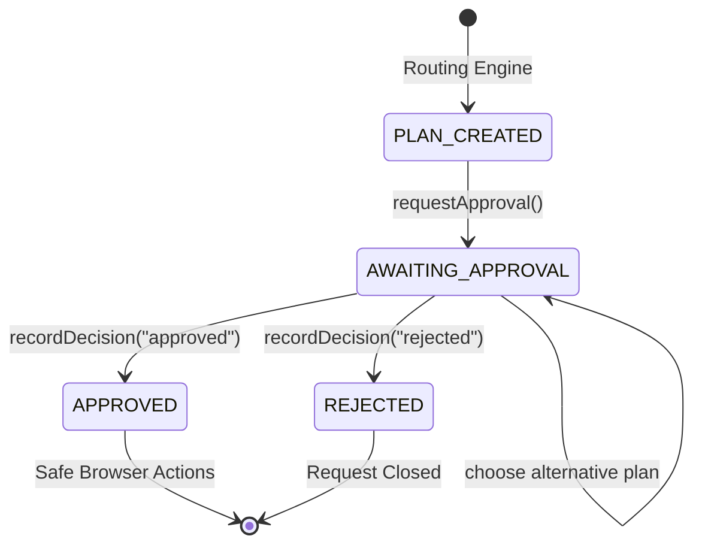

# Stage 6: Approval Gate & Safe Action System

## 1. Overview & Purpose
In autonomous reverse-logistics, autonomous agents must **never** take real-world financial or legal actions (such as booking pickups, incurring fees, or committing scrap) without explicit, informed human approval.

Stage 6 introduces:
1. **The Approval Gate**: An evidence-backed gate transitioning requests from `PLAN_CREATED` to `AWAITING_APPROVAL`, presenting a comprehensive Approval Card, and recording explicit user decisions (`APPROVED` or `REJECTED`).
2. **Deterministic Safe Action Enforcement (`assertActionAllowed`)**: A tamper-proof entry point protecting downstream browser automation. Any attempt to execute a booking without valid approval, with a stale plan hash, with an already-used idempotency key, or with an unexpected fee change is blocked and logged.
3. **Append-Only Action Log**: Every action attempt (whether permitted or blocked) is logged to `.data/action-log.jsonl` with timestamp, request ID, leg ID, recycler, plan hash, idempotency key, and block reasons.

---

## 2. Domain Data Model & State Machine



### State Transitions
- **`PLAN_CREATED` $\to$ `AWAITING_APPROVAL`**: Triggered via `requestApproval()`. Requires `PlanEvidence` (`planId`, `planHash`, `approvalReason`).
- **`AWAITING_APPROVAL` $\to$ `APPROVED`**: Triggered via `recordDecision({ decision: 'approved', decidedBy, planHash })`. Creates Plan Legs in `APPROVED` state with cryptographically unique idempotency keys: `sha256(planHash:legId:recyclerId)`.
- **`AWAITING_APPROVAL` $\to$ `REJECTED`**: Triggered via `recordDecision({ decision: 'rejected', decidedBy, reason })`. Creates zero legs and marks request terminal `REJECTED`.
- **Alternative Plan Selection**: If the user selects an alternative plan (`--choose-plan=<rank>`), the request transitions back through `PLAN_CREATED` $\to$ `AWAITING_APPROVAL` with the new plan's hash, invalidating any prior decision records.

---

## 3. Approval Reasons & Approval Card

Every plan evaluated by ReRoute generates a deterministic list of `ApprovalReason` flags:
- **`BOOKING_SUBMISSION`**: **Always present**. Every booking submission requires human sign-off.
- **`FEE_CAP_EXCEEDED`**: Present if the total pickup fees exceed the user's stated fee cap (`feeCapInr`).
- **`FEE_CHARGED`**: Present if any pickup leg incurs a non-zero fee.
- **`REGISTRY_WARNING`**: Present if any recycler in the plan is not in `REGISTERED` status (e.g. `NOT_FOUND` or application in process).
- **`ESTIMATED_WEIGHT_NEAR_THRESHOLD`**: Present if scrap weight is within 1 kg of a recycler weight threshold.

### Canonical Plan Hashing with Slot Preferences
`hashPlan` computes a SHA-256 digest over the canonical JSON representation of:
- `legs`: sorted by ID, including recycler ID, item IDs, items, estimated fee, estimated payout, slot.
- `slotPreference`: `{ day: 'earliest' | 'YYYY-MM-DD', window: 'morning' | 'afternoon' | 'any' }`.
- `totalEstimatedFee` & `totalEstimatedPayout`.

If a user alters slot preference or leg assignments, `planHash` changes immediately. Prior approvals citing an older `planHash` become stale and are rejected.

---

## 4. Safe Action Gate (`assertActionAllowed`)

Before any browser action or booking submission script executes, it MUST call:
```ts
assertActionAllowed({
  leg: PlanLeg,
  plan: Plan,
  approval: DecisionRecord | null,
  action: "submit_booking",
  observedFeeInr: number,
  usedIdempotencyKeys?: Set<string> | string[],
})
```

### Safety Pre-Conditions Enforced:
1. **Valid Leg State**: Leg must be in `APPROVED` state (or `SUBMITTING` when resuming after human verification). Any other state throws `SafeActionBlockedError(INVALID_LEG_STATE)`.
2. **Approved User Decision**: An approval record must exist with `decision: "approved"`. Lacking approval throws `SafeActionBlockedError(NO_USER_APPROVAL)`.
3. **Plan Hash Match (Stale Approval Guard)**: The approval record's `planHash` must match the current `plan.planHash`. A mismatch throws `SafeActionBlockedError(STALE_APPROVAL_PLAN_CHANGED)`.
4. **Idempotency Key Reuse Guard**: The leg's idempotency key must not have been previously recorded as submitted. Duplicate submission throws `SafeActionBlockedError(IDEMPOTENCY_KEY_REUSED)`.
5. **Observed Fee Match (Fee Discrepancy Guard)**: The fee observed on the live recycler form MUST exactly equal `leg.estimatedFee`. If the recycler charges more than approved, it throws `FeeChangedReapprovalRequiredError(FEE_CHANGED_REAPPROVAL_REQUIRED)` and halts execution until re-approved.

---

## 5. Append-Only Action Audit Log

Every invocation of `assertActionAllowed` appends an entry to `.data/action-log.jsonl`:
```json
{
  "id": "e4f8b9d2-...",
  "timestamp": "2026-10-18T10:15:30.123Z",
  "requestId": "req-demo-01",
  "legId": "leg-deccan-01",
  "recyclerId": "deccan",
  "planHash": "a1b2c3d4...",
  "action": "submit_booking",
  "allowed": true,
  "approvedFeeInr": 180,
  "observedFeeInr": 180,
  "idempotencyKey": "f6e7d8..."
}
```
Blocked attempts log `allowed: false` with the exact `blockReason`.

---

## 6. CLI Usage & Demonstration

### 1. Generating a Plan and Presenting Approval Card
```bash
npm run plan -- "I have one dead Dell laptop, two old batteries and around 8 kg of newspaper in Kukatpally, Hyderabad. Don't charge me more than ₹150."
```
This parses intake, computes eligibility, scores routing plans, transitions to `AWAITING_APPROVAL`, saves the request state to `.data/requests/<requestId>.json`, and prints the Approval Card.

### 2. Approving a Plan
```bash
npm run approve -- --request=<requestId> --decision=approve
```
Transitions request to `APPROVED`, creates legs in `APPROVED` state with idempotency keys, and prepares the request for Stage 7 browser dispatch.

### 3. Rejecting a Plan
```bash
npm run approve -- --request=<requestId> --decision=reject --reason="Fee too high"
```
Transitions request to `REJECTED`, creates 0 legs, and closes the request.

### 4. Selecting an Alternative Plan
```bash
npm run approve -- --request=<requestId> --choose-plan=2
```
Switches active plan to Option 2, invalidates previous approvals, updates the plan hash, and presents the new Approval Card for decision.
