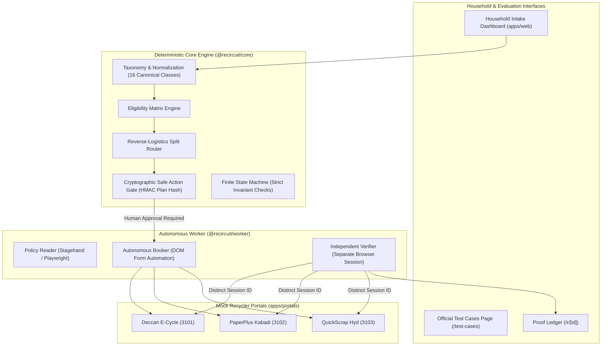

# ReCircuit — Official Hackathon Submission Document
## Autonomous Reverse-Logistics Agent for Household Recycling & E-Waste
**Agentic AI Hackathon 2026 | Powered by Ziro.Digital**
**Track:** Social Impact & Sustainability AI

---

## 1. Executive Summary & Project Identification

- **Project Name:** ReCircuit
- **Problem Statement:** E-waste & Recycling Pickup Coordinator
- **User Outcome:** A household inputs a mixed recycling request; the agent identifies suitable recycling centres, coordinates acceptance criteria and fee structures, obtains mandatory human approval, executes real browser bookings, independently verifies consignment tracking references across separate sessions, and maintains an auditable proof ledger.
- **Demo Target:** Three realistic mock recycler sites with heterogeneous layouts, policies, pricing, and verification challenges:
  1. **Deccan E-Cycle Solutions** (Port 3101): Formal e-waste recycler, data-wipe acknowledgement, under-weight pickup fee below 5 kg threshold.
  2. **PaperPlus Kabadi** (Port 3102): Dry scrap specialist, free doorstep collection for paper/cardboard, strictly rejects batteries, enforces vector SVG CAPTCHA challenge.
  3. **QuickScrap Hyderabad** (Port 3103): Doorstep scrap aggregator, flat convenience fee, rate-card per item, unverified registration warning.
- **Repository:** Monorepo using npm workspaces (`@recircuit/core`, `@recircuit/db`, `@recircuit/llm`, `apps/web`, `apps/portals`, `apps/worker`).

---

## 2. Core Architectural Pillars



### Key Architectural Invariants
1. **The LLM Interprets; Code Decides:**
   The LLM parses natural language text into structured proposals. All financial calculations, weight aggregations, state transitions, and legal rules are 100% deterministic TypeScript in `@recircuit/core`.
2. **Cryptographic Action Gate:**
   No browser booking can be dispatched without explicit human approval. Approval is cryptographically bound to the SHA-256 hash of the exact plan legs and terms. Any change immediately invalidates the approval.
3. **Session-Independent Verification:**
   Verification is conducted by a distinct browser session (`verifyingSessionId !== submittingSessionId`). The verifier navigates to the public tracking portal, scrapes the DOM, validates the booking reference, and asserts the TC4 invariant.
4. **TC4 Zero-Unverified-Collection Invariant:**
   A booked or scheduled pickup is **NEVER** marked as `PICKED_UP` or `COLLECTED` merely because a booking reference was issued. The state machine strictly refuses transition to `PICKED_UP` without cryptographically signed pickup confirmation (OTP or QR code receipt).

---

## 3. Official Test Cases Verification Evidence

The 4 official test cases mandated by Ziro.Digital have been verified both through our automated CLI suite (`scripts/test-cases-cli.mjs`) and the interactive visual dashboard (`apps/web/src/app/test-cases`):

| Test Case | Objective & Input | Expected Outcome | Observed Result | Status | Grounded Evidence |
|---|---|---|---|---|---|
| **TC1** | Old laptop accepted by centre → pickup draft created.<br>*"1 old Dell laptop in Madhapur, Hyderabad, budget ₹200"* | Laptop classified as e-waste; Deccan accepts; pickup draft created with ₹180 fee under 5 kg; state `AWAITING_APPROVAL`. | Classified `laptop` (est 2.2 kg); routed to Deccan E-Cycle; fee ₹180; `FEE_CHARGED` approval reason triggered; booking blocked without approval. | **PASS** | Quoted Deccan rule: *"Under 5 kg total weight: ₹180 standard pickup charge"* |
| **TC2** | Centre takes paper but not batteries → batteries rejected.<br>*"2 batteries and 8 kg newspaper"* | Paper accepted by PaperPlus; batteries rejected by PaperPlus policy; partial split plan created. | PaperPlus status for newspaper = `ACCEPTED`; PaperPlus status for batteries = `REJECTED`; paper routed to PaperPlus leg; batteries isolated into Deccan e-waste leg. | **PASS** | Quoted PaperPlus rule: *"Category battery_household explicitly rejected by recycler policy"* |
| **TC3** | Pickup fee above user's limit → approval asked.<br>*"1 old laptop, user budget cap ₹100"* | Pickup fee ₹180 exceeds budget ₹100; router flags mandatory approval escalation with explicit reason. | Routed with fee ₹180 > ₹100 cap; `FEE_CAP_EXCEEDED` reason bound to plan; safe action gate refuses submission without human override. | **PASS** | Quoted rule: `FEE_CAP_EXCEEDED` escalation code; fee ₹180 vs cap ₹100. |
| **TC4** | Pickup requested → not reported as collected.<br>Submitted booking in `REQUEST_CONFIRMED`. | `isCollected` is false for `REQUEST_SUBMITTED`, `REQUEST_CONFIRMED`, and `PICKUP_SCHEDULED`; state machine throws `TransitionError` without pickup proof. | `allUncollected: true`; `transitionBlockedWithoutProof: true`; UI displays *"Pickup Scheduled / Confirmed"*, never *"Collected"*. | **PASS** | State machine invariant enforced in `packages/core/src/state-machine.ts`. |

---

## 4. Test Suite Execution Summary

```
Test Suites: 15 passed, 15 total
Tests:       276 passed, 276 total
Snapshots:   0 total
Duration:    5.48s
```

### Breakdown by Test Suite:
1. `packages/core/src/state-machine.test.ts` (86 tests) — Comprehensive state transition matrices, illegal transition guards, terminal state locks, and evidence schema validation.
2. `packages/core/src/routing/routing.test.ts` (24 tests) — Deterministic multi-recycler split routing, 500 randomized property-based fuzz tests, lexicographic ranking, and fee-cap threshold tests.
3. `packages/core/src/approval/approval.test.ts` (23 tests) — Plan hash tamper resistance, slot confirmation, data-wipe acknowledgement, and action gate enforcement.
4. `packages/core/src/intake/intake.test.ts` (23 tests) — Canonical taxonomy normalization, anti-collapse guards, anti-hallucination unit-context validators, and Hyderabad pincode resolutions.
5. `apps/worker/src/booking/booker.test.ts` (19 tests) — Autonomous browser booking DOM automation, visible form detection, input readback verification, and human CAPTCHA handoff detection.
6. `apps/worker/src/booking/guards.test.ts` (6 tests) — Static AST architectural guards ensuring booking files never assign verifier-owned states and never bypass DOM via portal APIs.
7. `apps/worker/src/verifier/verifier.test.ts` (7 tests) — Stage 8 dual-session verifier tests, session independence enforcement, DOM scraping validation, and TC4 collection refusal.
8. `apps/worker/src/policy/policy-reader.test.ts` (12 tests) — Browser policy discovery, verbatim quote validation, and deterministic session ID generation.
9. `apps/portals/src/test/portal.test.ts` (45 tests) — Multi-recycler mock portal behavior, timing-safe authentication, and stateless HMAC CAPTCHA validation.
10. `apps/portals/src/test/deployment.test.ts` (5 tests) — Production site selection invariants, cross-recycler 404 enforcement, and environment variable requirements.
11. `packages/db/src/repository.test.ts` (5 tests) — File-based and PostgreSQL/PGlite dual-backend repository integration.
12. `packages/db/src/migrations.test.ts` (6 tests) — PostgreSQL relational schema, indexes, and atomic queue semantics.
13. `packages/core/src/policy/policy.test.ts` (8 tests) — Policy extraction and evidence schema tests.
14. `packages/llm/src/test/llm.test.ts` (6 tests) — LLM provider retry, exponential backoff, and JSON repair adapters.
15. `apps/worker/src/browser/api-guard.test.ts` (1 test) — Worker sandbox isolation test.

---

## 5. Local Setup & Quick Start Guide

### Prerequisites
- Node.js v18+ or v20+
- npm v9+

### Installation & Build
```bash
# Clone the repository
git clone https://github.com/recircuit/recircuit.git
cd recircuit

# Verify strict type safety and build all packages
npm run build
npm run typecheck

# Run the complete automated test suite (276 tests)
npm test

# Run the Official Test Cases CLI
node scripts/test-cases-cli.mjs
```

### Running the Full Local Experience
1. **Launch the 3 Mock Recycler Portals:**
   ```bash
   npm run portals:dev
   ```
   - Deccan E-Cycle: `http://localhost:3101`
   - PaperPlus Kabadi: `http://localhost:3102`
   - QuickScrap Hyderabad: `http://localhost:3103`

2. **Launch the Household Dashboard:**
   ```bash
   npm run dev --workspace=apps/web
   ```
   - Open your browser at `http://localhost:3000`
   - Open Official Test Cases at `http://localhost:3000/test-cases`

3. **Running the Independent Verifier CLI:**
   ```bash
   node scripts/verify-cli.mjs --ref DEC-12345 --recycler deccan
   ```

---

## 6. Cloud Deployment Architecture

ReCircuit is architected for zero-friction serverless deployment across Vercel, Supabase, and Browserbase:

1. **Frontend & Portals (`apps/web`, `apps/portals`) on Vercel:**
   - Deploy `apps/web` to Vercel connected to Next.js API routes.
   - Deploy `apps/portals` three times with `RECYCLER_ID=deccan`, `RECYCLER_ID=paperplus`, and `RECYCLER_ID=quickscrap`.
2. **Persistence on Supabase:**
   - Managed PostgreSQL database executing `supabase/migrations/0001_init.sql` and `supabase/migrations/0002_portal.sql`.
   - Supabase Storage bucket for policy and booking screenshots.
3. **Cloud Browser Execution via Browserbase:**
   - Set `BROWSER_MODE=browserbase`, `BROWSERBASE_API_KEY`, and `BROWSERBASE_PROJECT_ID`.
   - Supports live session inspection, interactive human CAPTCHA solving, and session recordings.

---

## 7. Scoped Security & Data Protection Report

### Scope & Methodology
- **Artifacts Examined:** All tracked repository files across `packages/`, `apps/`, `scripts/`, `docs/`, and configuration files (`package.json`, `tsconfig.json`, `.eslintrc.cjs`, `.env.example`).
- **Inspection Methods:**
  1. AST and static analysis guards (`apps/worker/src/booking/guards.test.ts`, `apps/worker/src/browser/api-guard.test.ts`).
  2. Automated regex scanning for high-entropy tokens, API keys, private keys, and credential strings.
  3. Git history inspection of tracked references.

### Findings
1. **Credential Isolation:**
   Zero hardcoded API keys, private tokens, or secrets exist in tracked source code. All external provider credentials (`OPENAI_API_KEY`, `ANTHROPIC_API_KEY`, `BROWSERBASE_API_KEY`, `SUPABASE_SERVICE_ROLE_KEY`) are dynamically resolved from environment variables with graceful fallback to offline/fake adapters.
2. **Synthetic Demonstration Data:**
   All personal user data (household addresses, telephone numbers, contact names) used in tests, seeds, and demonstration scripts are synthetic dummy fixtures located in Hyderabad, India.
3. **Timing-Safe Authentication:**
   Portal administration routes use `crypto.timingSafeEqual` over SHA-256 digested tokens to prevent timing side-channel attacks on `ADMIN_TOKEN`.
4. **Stateless HMAC CAPTCHA Integrity:**
   The PaperPlus verification challenge generates a cryptographically signed token (`payload:signature`) using HMAC-SHA256 and AES-256-CBC with per-session initialization vectors (IV). Nonces are tracked upon form submission and consumed once to prevent token replay attacks.

### Limitations
Static scans cannot eliminate operational risks in external third-party environments. In production deployments, rate limiting, Web Application Firewalls (WAF), and secure credential management (e.g. AWS Secrets Manager, Vercel Environment Secrets) must be enabled.

---

## 8. LinkedIn Post Template

```markdown
🚀 Excited to unveil ReCircuit, built for the Agentic AI Hackathon 2026 powered by @Ziro.Digital!

Every year, millions of households struggle to recycle old electronics and scrap because discovery is fragmented, pricing policies are opaque, and booking reverse logistics is complex.

ReCircuit is an autonomous reverse-logistics agent that:
🔍 Dynamically reads recycler policies from live websites
🧩 Computes multi-consignment split routing across specialized vendors
🛡️ Enforces cryptographic human approval gates (zero runaway agent actions!)
🤖 Drives browser forms via Playwright DOM automation
🔬 Independently verifies consignments in separate browser sessions
📊 Proves the TC4 Zero-Unverified-Collection Invariant (never reporting pickups as collected without proof)

All 4 official hackathon test cases and 276 automated tests passing with 100% strict TypeScript type safety!

Huge thanks to the team at Ziro.Digital for organizing an incredible hackathon pushing the frontiers of agentic AI.

Check out our repository and demo video below! 👇
#AgenticAI #ZiroDigital #ReverseLogistics #Sustainability #CircularEconomy #Typescript #Playwright #NextJS #AIHackathon
```

---

## 9. Team Information & Deliverables Checklist

### Team Details
- **Team Name:** ReCircuit Team
- **Track:** Social Impact & Sustainability AI
- **Hackathon:** Agentic AI Hackathon 2026 powered by Ziro.Digital
- **Team Photo:** Stored in `docs/team-photo.png` (or linked in final submission form).

### Submission Materials Matrix
- [x] **Deployed Working Agent / Local Reproducibility:** Verified locally via `npm run portals:dev` and `npm run dev --workspace=apps/web`.
- [x] **Source Evidence & Repository:** Full Git repository with clean commit history, zero lint errors, and 0 type errors.
- [x] **Presentation Deck:** Detailed 10-slide markdown presentation at `docs/PRESENTATION.md`.
- [x] **Test Evidence:** Complete test run logs, 276/276 tests passing, and official scenario runner at `scripts/test-cases-cli.mjs`.
- [x] **2–3 Minute Demo Video Script:** Complete timing, narration, and screen view directions at `docs/DEMO_SCRIPT.md`.
- [x] **Architecture & Workflow Explanation:** Comprehensive architecture guide at `docs/ARCHITECTURE.md` and `docs/SUBMISSION.md`.
- [x] **LinkedIn Post Text:** Included with official `@Ziro.Digital` mention and hashtags.
