# Geospatial routing stage board — local verification

Updated 2026-10-24T00:43:42.869023+05:30. Isolated branch `feature/geospatial-pickup-routing`, source checkpoint `0f4610685e40dc58391eaf8f0e2a69c8dd2b3b92`; foundation `5ad7cb1`. Documentation/polish checkpoint is the commit containing this board. Starting release `78faed277c13c4bedc121645386ffea3dd74963c` remains preserved in the original worktree, together with its existing report edit.

| Stage | Local gate | Paths / executed evidence | Limitations |
|---|---|---|---|
| 0 Baseline/architecture | PASS | Baseline compile/lint and 91 tests, `baseline-*.log`; architecture below | Initial inspection start was not timestamped; no invented duration |
| 1 Validated conversion | PASS | `contracts.ts`, conversion cases in `geospatial.test.ts`; Zod models and pure row-weight semantics | Legacy missing data is excluded |
| 2 Provider contracts | PASS for offline + public HeiGIT sample | `providers.ts`, `heigit.server.ts`, offline failures and `live-public-*.json` | Private customer routing not authorized/verified; MapTiler account/browser check BLOCKED |
| 3 Optimization/independent replay | PASS | `optimizer.ts`, `validator.ts`, oracle/load/window/corruption cases, `benchmark-1792781220000.json` | Exact proof only ≤7 complete-service one-vehicle instances; larger results heuristic |
| 4 Services/storage/security | PASS for isolated local preview | `service.ts`, `authorization.server.ts`, `verification-bridge.ts`, API, service/security tests and actual reload | Production shared persistence/distributed coordination intentionally unsupported; production guard retained |
| 5 Operator UI/analytics | PASS map-independent workflow | `admin/routing/page.tsx`, fleet form, numbered SVG/list, fair comparison, screenshots | MapTiler disabled; no unsupported fuel/emissions factors |
| 6 Verification/regression | PASS local scope | 354 regression tests; accepted type/lint/build exits 0; seven actual UI states plus six labelled UI fixtures | No live customer workflow or production deployment claimed |
| 7 Documentation/release preparation | PASS for local preview preparation | REPORT, CONTRACTS, OPERATIONS, storyboard, local commits | Production activation requires the explicit prerequisites in OPERATIONS; not release-ready for production |
| MapTiler account settings + actual browser-origin enforcement | BLOCKED | Provider docs reviewed; `cua.getState` had no enabled browser/app session | One HTTP 200 probe is inconclusive; no browser key exposure; exact local origins only |
| Push/deployment/shared migration/production writes | NOT STARTED | None performed | Not authorized |

Stage check timestamps and measured process/check-window elapsed times are in `C:\Users\Manish\Downloads\ReCircuit-Local\.data\geospatial-20261023\evidence\stage-verification-timing.json`. The append-only command log is `C:\Users\Manish\Downloads\ReCircuit-Local\.data\geospatial-20261023\evidence\execution.jsonl`. This records actual command start/end, elapsed milliseconds and exit codes. It does not fabricate full-stage coding time: initial editing/inspection windows were not fully instrumented, and development/checks overlapped.

```mermaid
flowchart LR
 A[Header-authenticated fixed tenant] --> B[Read existing portal bookings]
 B --> C[Read-only approved household verification bridge]
 C --> D[Pure booking conversion and exclusions]
 D --> E[Reviewed coordinate and fleet versions]
 E --> F[Immutable input fingerprint + directed matrix]
 F --> G[Bounded optimization and feasible baseline]
 G --> H[Separate schema/constraint replay]
 H --> I[Immutable tenant proposal history]
 I --> J[Authorized current/stale read + numbered map/list]
```

Routing has no booking mutation dependency. Current provider configuration, historical Gemini/Groq extraction evidence, pricing, approval hashes, independent booking verification and operational status remain separate. No LLM participates in routing calculations. Detailed units, contracts and permissions are in CONTRACTS and OPERATIONS.
